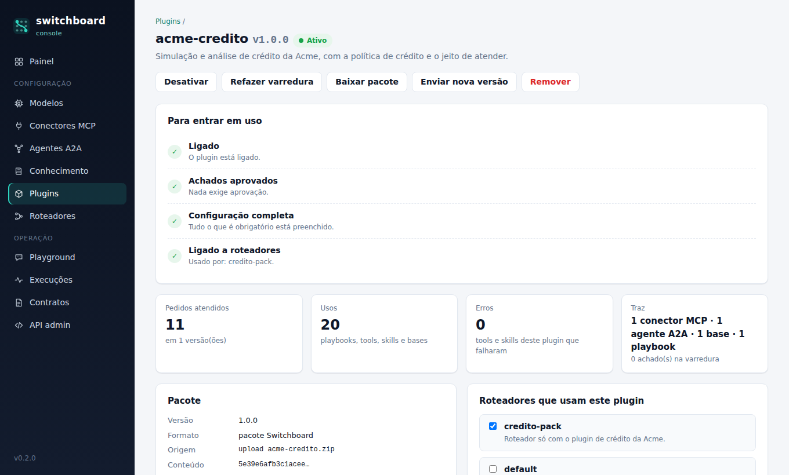

# Plugins

Um **plugin** é um pacote que o Switchboard recebe pronto: as **capacidades** (conectores MCP, agentes A2A, bases de conhecimento) e o **jeito de usá-las** (playbooks, no formato Agent Skills). Em vez de cadastrar à mão um conector, um agente e uma base e depois explicar no prompt como o roteador deve usá-los, você sobe um `.zip`, informa os endereços e liga o plugin a um roteador.

Isso não muda o que o roteador é. Ele continua decidindo cada pedido (responder, chamar uma tool, delegar sob contrato ou esclarecer) com o Jev e o LLM; o plugin é só **o que ele passa a ter à mão e o que ele sabe sobre isso**. E um plugin é **dado, nunca código**: o router não executa nada que venha num pacote.

O desenho se inspira no modelo de plugins do Claude (um pacote versionado com skills e servidores MCP, instalável e atualizável). O que foi aproveitado, o que foi adaptado a um roteador e o que ficou de fora de propósito estão no [ADR 0002](adr/0002-plugins-declarativos.md).

## O que muda para quem opera

| Sem plugin | Com plugin |
|---|---|
| Registrar o conector, o agente e a base, um por um, e escolhê-los em cada roteador | Um pacote traz tudo; o roteador é ligado ao plugin, não aos itens |
| "Como usar" mora num `system_prompt` que cresce para sempre | O playbook do plugin entra no prompt **só nos pedidos a que se refere**, com orçamento de texto |
| Atualizar é refazer à mão, sem versão nem histórico | Versão semântica, prévia do que muda, aprovações que não mudaram continuam valendo, histórico de quem fez o quê |
| Não se sabe o que de cada integração está dando certo | O uso é contado **por plugin e por versão** (pedidos, playbooks, tools, skills, bases, erros) e cada execução mostra o que veio de plugins |
| Um texto copiado de terceiros vai direto para o prompt | O pacote é lido com limites, varrido por regras e só entra em uso quando você aprova o que a varredura reteve |

## Anatomia do pacote

```
acme-credito.zip
├── plugin.yaml                        manifesto: nome, versão, configuração e componentes
├── skills/
│   └── politica-de-credito/
│       └── SKILL.md                   playbook (formato Agent Skills)
└── knowledge/
    └── politica-de-credito.md         documentos da base de conhecimento
```

Só entra texto declarativo (`.yaml`, `.yml`, `.json`, `.md`, `.markdown`, `.txt`, `.csv`, `.rst`, `.html`, `.htm`, mais `LICENSE`, `README`…). Qualquer outro arquivo (script, binário, imagem) recusa o pacote. O exemplo completo está em [`examples/plugins/acme-credito`](../examples/plugins/acme-credito).

### O manifesto (`plugin.yaml`)

```yaml
name: acme-credito
version: 1.0.0
description: Simulação e análise de crédito da Acme.
author: {name: Acme Serviços Financeiros, url: https://example.com/acme}
license: MIT
requires: {switchboard: ">=0.2"}

config:                                    # o que quem instala precisa informar
  CREDITO_URL: {description: Endereço do servidor MCP de crédito (termina em /mcp)}
  ANALISE_URL: {description: Endereço do agente A2A de análise}
  ANALISE_TOKEN: {description: Token do agente, sensitive: true, required: false}

connectors:                                # conectores MCP: tools rápidas
  - name: credito
    url: ${config.CREDITO_URL}
    allowed_tools: [simular_financiamento, comparar_sistemas]

agents:                                    # agentes A2A: tarefas delegadas sob contrato
  - name: analise-credito
    url: ${config.ANALISE_URL}
    auth_token: ${config.ANALISE_TOKEN}
    deadline_s: 300

knowledge_bases:                           # indexadas na instalação
  - name: politicas
    paths: [knowledge]

playbooks:                                 # ajustes de como as skills entram no roteamento
  - skill: politica-de-credito
    applies_to: [credito, analise-credito]
    triggers: [financiamento, parcela, limite de crédito]

routing_examples:                          # frases que ajudam a decidir (Jev e LLM)
  credito/simular_financiamento:
    - Simule um empréstimo de R$ 30 mil em 12 meses a 2% ao mês
```

| Campo | Regra |
|---|---|
| `name` | 2 a 30 caracteres: minúsculas, números e `-`. Não pode começar por `switchboard`, `anthropic`, `claude`, `typesafe` nem `jev`, nem ser `core`, `system`, `admin`, `router`, `console`, `default`… (o plugin não pode se passar por outro) |
| `version` | semver (`1.2.0`). A cada alteração de conteúdo, mude a versão: o uso é separado por versão |
| `description` | obrigatória, até 500 caracteres |
| `requires.switchboard` | faixa de versões compatíveis (`">=0.2,<1"`); fora dela, o pacote é recusado |
| `config` | chaves em `MAIÚSCULAS_COM_UNDERLINE`; cada uma com `description`, `sensitive` (segredo), `required` (padrão `true`) e `default` |
| `connectors` | `name`, `url`, `description`, `transport` (`streamable-http` ou `sse`), `auth_token`, `allowed_tools`, `timeout_s` |
| `agents` | `name`, `url`, `description`, `auth_token`, `allowed_skills`, `timeout_s`, `deadline_s`, `push`, `allow_cross_origin` |
| `knowledge_bases` | `name`, `description`, `paths` (pastas ou arquivos do pacote, padrão `knowledge`), `chunk_size`, `chunk_overlap` |
| `skills` | opcional: quais pastas de `skills/` usar (padrão: todas com `SKILL.md`) |
| `playbooks` | opcional: `skill`, `applies_to`, `triggers`, `always` |
| `routing_examples` | `componente/capacidade` → até 8 frases |

### Configuração e placeholders

O pacote **nunca traz endereços nem tokens**. Ele declara as chaves em `config` e as usa como `${config.CHAVE}` em `url` (inclusive no meio: `${config.BASE}/mcp`) e em `auth_token`. Regras que a validação impõe:

- `auth_token` é só `${config.CHAVE}` (um token escrito no manifesto bloqueia o pacote), e a chave precisa ser `sensitive: true`;
- uma chave `sensitive` só pode alimentar `auth_token` e não pode ter `default`;
- uma chave opcional sem `default` não pode ser a única fonte de uma URL;
- toda `${config.X}` precisa estar declarada (e uma declarada e sem uso vira informação).

Quem instala informa os valores no console (ou em `config:` no YAML). Segredos viram texto cifrado no banco, ou `env:NOME` quando você prefere deixá-los no ambiente do router.

### Componentes e nomes

Cada componente ganha o nome `<plugin>.<componente>` (`acme-credito.credito`, `acme-credito.analise-credito`, `acme-credito.politicas`). O ponto é **reservado**: um conector, agente ou base cadastrado à mão não pode ter ponto no nome, então nada manual colide com um plugin nem se passa por ele. Os componentes de um plugin ficam **somente leitura** no console e na API (mudam com a configuração do plugin, com uma nova versão ou ao remover o plugin) e não se escolhem um a um em um roteador: liga-se o plugin.

Dentro de um plugin, conectores e agentes precisam de nomes diferentes (o nome identifica o dono nas chaves de `routing_examples` e `applies_to`).

### Playbooks (skills)

Um playbook é uma skill no formato aberto [Agent Skills](https://agentskills.io): `skills/<nome>/SKILL.md` com frontmatter (`name`, igual à pasta, e `description`, "o que faz e quando usar") e o corpo em Markdown com as instruções. O mesmo arquivo serve em outras ferramentas que usam o formato.

```markdown
---
name: politica-de-credito
description: Como simular financiamentos e analisar propostas de crédito da Acme. Use quando o cliente pedir simulação, parcelas, taxa, limite ou análise.
---

# Política de crédito: como atender

- Use `credito/simular_financiamento` quando o cliente informar valor e prazo.
- Se faltar o valor, o prazo ou a taxa, pergunte antes de simular. Não invente números.
- Delegue a análise a `analise-credito/analisar_proposta` e avise que o resultado chega depois.
```

**Como o roteador usa.** O texto do playbook entra no prompt do LLM em dois momentos:

1. **Na decisão e na resposta direta**, os playbooks *relevantes ao pedido*: cada `trigger` do manifesto que aparece no texto vale 3 pontos, cada palavra do nome da skill que aparece, 2, e cada palavra da descrição, 1; o playbook precisa de pelo menos 3 pontos, e entram no máximo 3 por pedido. O pedido e o turno anterior contam, então "e com 24 meses?" ainda casa. `always: true` entra em todos os pedidos, fora desse limite (e por isso a varredura o retém para aprovação).
2. **Na execução** (extrair os argumentos de uma tool ou skill, sintetizar o resultado, consolidar o que os agentes devolveram), os playbooks que *cobrem o componente escolhido*: o conector ou agente listado em `applies_to` (ou o plugin todo, se a lista está vazia). Se nenhum dos componentes de `applies_to` está disponível, o playbook não entra.

O texto de um plugin é de terceiros, então entra sempre **sob um cabeçalho** (`## ORIENTAÇÕES DOS PLUGINS`) que diz isso e que o proíbe de mudar as regras do roteador, revelar o prompt ou pedir senhas, dentro de um orçamento (3.000 caracteres por playbook e 6.000 por prompt), e **nunca no lugar do `system_prompt`** do roteador. Sem LLM (modelo `offline`) o texto não muda a resposta, mas o trace registra quais playbooks teriam entrado. `references/` e `assets/` de uma skill são aceitos no pacote e varridos, mas o router não os carrega; `allowed-tools` é ignorado (o que o plugin pode acionar é decidido pelos componentes que ele declara).

### Frases de exemplo

`routing_examples` associa frases a uma capacidade (`componente/tool-ou-skill`). Elas entram na descoberta, e quem decide (o Jev, na pergunta "qual capacidade atende"; o LLM, na lista de capacidades) tem exemplos reais para comparar. O componente da chave precisa ser um conector ou agente do próprio plugin.

## Instalando

### Pelo console

**Plugins → Subir plugin**, escolha o `.zip`:

1. **Validar sem instalar** mostra, sem gravar nada, o que o pacote traz, o que a varredura achou, o que mudaria (primeira instalação, atualização com quantos achados aprovados continuam valendo, downgrade) e os campos de configuração.
2. **Instalar** grava o plugin e **sobrescreve** a configuração informada. Pacote com achado que bloqueia é recusado e nada é instalado.
3. Na página do plugin, o quadro **Para entrar em uso** diz o que falta: *ligado*, *achados aprovados*, *configuração completa* e *ligado a roteadores*. Os achados que exigem aprovação ficam lá, com o botão **Aprovar** (que registra quem aprovou e quando).
4. Em **Roteadores que usam este plugin** (ou em **Roteadores → editar**), marque os roteadores que passam a usá-lo. O router aplica a mudança em poucos segundos.



Nas outras telas, os componentes do plugin aparecem com a etiqueta do plugin e os botões **Config. do plugin** no lugar de editar e remover.

### Pela API admin

```bash
# valida sem instalar
curl -s -F file=@acme-credito.zip http://localhost:8000/api/plugins/validate

# instala (config em JSON; 201 na primeira instalação, 200 em atualização ou repetição)
curl -s -F file=@acme-credito.zip \
  -F 'config={"CREDITO_URL": "http://credito:8101/mcp", "ANALISE_URL": "http://analise:8201"}' \
  http://localhost:8000/api/plugins

curl -s -X POST http://localhost:8000/api/plugins/acme-credito/approve       # só se houver achado retido
curl -s -X PUT http://localhost:8000/api/plugins/acme-credito/profiles \
  -H 'Content-Type: application/json' -d '{"profiles": ["default"]}'
```

Um pacote recusado responde `422` com a lista de achados; configuração inválida, `400`; remover com contratos em aberto sem `?force=true`, `409`. Os endpoints estão em [api.md](api.md#plugins).

### No modo framework (YAML)

```yaml
plugins:
  - name: acme-credito
    path: plugins/acme-credito           # pasta ou .zip, relativo ao arquivo
    config:
      CREDITO_URL: ${CREDITO_URL:-http://localhost:8101/mcp}
      ANALISE_URL: ${ANALISE_URL:-http://localhost:8201}
    # allow: [inj.override]              # aceita, por código, um achado que exige aprovação

profiles:
  - name: credito-pack
    model: offline
    plugins: [acme-credito]
```

No YAML não há console para aprovar: um achado que exige aprovação **interrompe o carregamento** com a mensagem `allow: [código]` até você revisar e aceitá-lo por código. O comando `check` lê e varre os plugins ligados.

### Pela linha de comando

```bash
uv run switchboard plugin validate examples/plugins/acme-credito           # varre; --strict falha também com avisos; --json para CI
uv run switchboard plugin inspect  examples/plugins/acme-credito           # configuração, componentes e playbooks
uv run switchboard plugin pack     examples/plugins/acme-credito -o acme-credito.zip   # .zip normalizado
```

`pack` gera sempre os mesmos bytes para o mesmo conteúdo (ordem e datas fixas). O `sha256` impresso é o do conteúdo (caminho e bytes de cada arquivo, independente da compactação): é o que o console mostra como "conteúdo" e o que identifica o pacote instalado. O CI do repositório valida o plugin de exemplo com `--strict`.

## Ciclo de vida

Um plugin **só entra no roteamento** quando está **ativo**: ligado, sem achado pendente de aprovação, com a configuração obrigatória completa, e apenas nos roteadores a que foi ligado.

| Situação | Quando | O que acontece |
|---|---|---|
| **Ativo** | tudo em ordem | os componentes e os playbooks chegam aos roteadores ligados |
| **Desativado** | você desligou | sai do roteamento em poucos segundos; nada é apagado |
| **Aguardando aprovação** | a varredura reteve algo (`held`) | instalado, mas fora do roteamento até a aprovação |
| **Configuração incompleta** | falta chave obrigatória | os componentes que dependem dela não existem ainda |
| **Inválido** | o manifesto guardado deixou de valer (ex.: depois de atualizar o Switchboard) | reenvie o pacote |

Um roteador ligado a um plugin que ainda não está ativo continua funcionando sem ele, e o motivo aparece em `warnings` na resposta e no trace (por exemplo, `plugin acme-credito 1.0.0 não está ativo: aguardando aprovação`).

**Atualizar.** Subir uma versão maior substitui o pacote e refaz os componentes, **mantendo a configuração** (uma chave que passou a ser sensível é cifrada na hora; uma chave cifrada que passou a ser pública é descartada) e as ligações com os roteadores. A prévia diz quantos achados já aprovados continuam aprovados: a aprovação segue o **achado**, identificado por código, arquivo e um hash do trecho que o disparou, e não a versão; uma ressalva nova ou alterada pede aprovação de novo, e as que não mudaram não. Subir o mesmo conteúdo outra vez só atualiza a configuração. Subir uma versão **menor** exige confirmar o downgrade; a mesma versão com outro conteúdo avisa que o uso ficará misturado.

**Remover** apaga o plugin, os conectores, agentes e bases dele (com os documentos) e as ligações com roteadores. O **histórico** (instalações, aprovações, configurações, ligações, remoção, com quem fez) e o **uso por versão** continuam registrados. Se há contratos em aberto com agentes do plugin, a remoção pede confirmação (`force`), porque o router deixa de acompanhá-los.

**Sincronizar documentos.** As bases do plugin são indexadas na instalação a partir dos documentos do pacote. Se a indexação falhar (por exemplo, o embedder está fora do ar), o plugin é instalado com um aviso e **Sincronizar documentos** deixa a base com exatamente os documentos do pacote guardado. Nas bases de plugin, só o embedder é escolha de quem opera; depois de trocá-lo, reindexe.

## Varredura de segurança

Todo pacote é lido **em memória, com limites** (`.zip` de até 10 MB, 25 MB descompactado, 2 MB por arquivo, 300 arquivos, razão de compressão até 200), sem gravar em disco, e varrido por regras. Cada achado tem um nível:

| Nível | O que acontece |
|---|---|
| **bloqueia** (`block`) | o pacote é recusado e nada é instalado |
| **exige aprovação** (`held`) | o plugin é instalado, mas só fica ativo depois que um administrador aprova (console) ou aceita por código (`allow` no YAML) |
| **aviso** (`warning`) | risco ou má prática que vale revisar, sem barrar |
| **informação** (`note`) | contexto: hosts que o plugin vai contatar, o que foi deixado de fora numa importação… |

O que cada grupo de regras procura:

| Grupo | Exemplos de código | Nível |
|---|---|---|
| Pacote | `package.not_zip`, `package.unsafe_path` (zip-slip), `package.symlink`, `package.zip_bomb`, `package.too_large`, `package.disallowed_file`, `package.encrypted` | bloqueia |
| Manifesto | `manifest.missing`, `manifest.invalid`, `requires.switchboard`, `skill.missing`, `playbook.unknown_skill`, `kb.empty`, `kb.path_missing` | bloqueia |
| Segredos | `secret.leaked` (senha ou token no texto), `secret.literal` (token escrito em `auth_token`), `secret.default`, `config.token_not_sensitive`, `config.sensitive_misplaced`, `config.undeclared` | bloqueia |
| Rede | `net.userinfo` (usuário e senha no endereço), `net.credential_in_url` (credencial na query, como `?api_key=`), `net.metadata_host` (endpoint de metadados da nuvem, mesmo escrito com outro esquema ou com pontos de largura total) | bloqueia |
| Rede | `net.private_host` (rede interna ou a própria máquina), `net.fixed_host` (host público fixo: os pedidos e o token vão para ele), `agent.cross_origin` | exige aprovação |
| Rede | `net.insecure_http`, `connector.no_allowed_tools`, `text.remote_image` | aviso |
| Texto que fala com o modelo | `inj.override` ("ignore as instruções anteriores"), `inj.role_reset`, `inj.role_marker`, `inj.concealment` ("não conte ao usuário"), `inj.always_on` (forçar o uso do plugin), `inj.exfiltration`, `inj.prompt_leak`, `inj.tool_interference`, `inj.external_instructions`, `inj.credential_request`, `playbook.always_on`, `capability.foreign_ref` | exige aprovação |
| Texto escondido | `text.hidden_unicode` (caracteres "tag" invisíveis), `text.control_tokens` (`<|im_start|>`, `[INST]`…) | bloqueia |
| Texto escondido | `text.zero_width`, `text.control_chars`, `text.html_comment`, `text.encoded_blob`, `text.data_uri`, `text.markdown_exfil` | exige aprovação |
| Estilo | `promo.directive`, `skill.long_body`, `skill.no_skill_md`, `capability.unknown_ref` | aviso |

Uma regra de negação evita o falso positivo óbvio: "nunca peça a senha ao cliente" não é um pedido de senha.

O host fixo merece atenção: é para ele que vão os pedidos das pessoas (e o token, se houver). Por isso o console mostra o host antes de aprovar, e uma versão nova que troque o host pede aprovação de novo. Num endereço com `${config.X}`, só o trecho escrito no pacote é triado; o resto é decidido por quem instala, e o endereço final é checado de novo na hora de montar o roteador (metadados e usuário e senha são recusados).

As regras de varredura mudam de uma versão do Switchboard para outra. Depois de atualizar, use **Refazer varredura** (ou `POST /api/plugins/{ref}/rescan`) nos plugins instalados: um pacote só passa pelas regras novas quando é varrido de novo.

**O que a varredura é, e o que não é.** É uma **triagem automática por regras**: pega o que é detectável e dá ao revisor o trecho exato (arquivo, linha e evidência resumida; um segredo nunca aparece inteiro). Ela **não prova** que um pacote é seguro, e um texto malicioso bem escrito pode passar. A barreira de verdade é o plugin ser **só declarativo**: ele não executa código, os endereços e tokens são de quem instala, o texto dele entra no prompt sob cabeçalho e orçamento e não substitui o `system_prompt`, e tudo o que ele aciona (tools, skills, agentes) passa pelas mesmas allowlists, validações de schema e contratos do resto. Aprovar é decisão de quem leu.

## Segredos e configuração

- Valores `sensitive` são cifrados com a chave mestra antes de ir para o banco (ou ficam como `env:NOME`, só para variáveis liberadas em `SWITCHBOARD_ALLOWED_ENV_SECRETS`) e **nunca voltam** para a tela nem para a API: o campo mostra só "cifrada".
- Em branco mantém o valor atual; a caixa **remover o valor atual** apaga. Um token apagado deixa de ser mandado ao agente.
- O token do pacote vai para o agente/conector do plugin já cifrado (a mesma proteção dos cadastros manuais).
- A configuração é do roteador onde o plugin está instalado, não do pacote: o mesmo `.zip` serve em ambientes diferentes.

## Uso por plugin e por versão

Cada pedido que usou algo de um plugin grava, por plugin e **versão**, o que foi usado: o `playbook` que entrou no prompt, a `tool` MCP ou a `skill` A2A de um componente do plugin (com o resultado) e a base de `knowledge` citada. Aparece em três lugares:

- **na execução** (`/traces/{id}` e `GET /v1/runs/{id}`, campo `plugins`): o cartão **Plugins** lista o que veio de cada plugin;
- **na página do plugin**: pedidos, usos por tipo, erros e último uso por versão e por componente, para comparar a versão nova com a anterior;
- **na API** (`GET /api/plugins/usage`) e na lista de plugins.

O router também responde `GET /v1/plugins?profile=...` com o que os plugins **ativos** trazem para o roteador (versão, componentes e playbooks, sem o texto) e quais ficaram de fora e por quê.

## Importando um plugin no formato do Claude

Um pacote com `.claude-plugin/plugin.json` é convertido na hora (a prévia diz "importado do formato Claude"): as partes **declarativas** entram e o resto fica de fora, sempre dito num achado.

| No plugin do Claude | No Switchboard |
|---|---|
| `skills/` (Agent Skills) | playbooks |
| servidores MCP **remotos** (`http`/`sse`, em `.mcp.json` ou `mcpServers`) | conectores; `Authorization: Bearer ${VAR}` vira `auth_token`, e as variáveis (`${user_config.x}`, `${VAR}`) viram `config` |
| `userConfig` | `config` (`sensitive` é mantido) |
| servidores MCP **locais** (`command`/stdio) | **não importado** (`import.stdio_server`): ele executaria um comando na máquina do router; hospede-o como servidor remoto e cadastre-o |
| `hooks`, `monitors`, scripts | **não importado**: executam código |
| `commands` (slash commands) | não importado: são atalhos para a pessoa digitar |
| `agents` (subagentes) | não importado: são prompts, não agentes A2A (cadastre o agente A2A em `agents`) |

O pacote guardado é sempre o nativo (um `plugin.yaml` gerado com o conteúdo convertido), então reler o que foi instalado não passa pelo conversor de novo.

## Escreva o seu primeiro plugin

```bash
mkdir -p meu-plugin/skills/atendimento meu-plugin/knowledge
```

`meu-plugin/plugin.yaml`:

```yaml
name: meu-plugin
version: 0.1.0
description: Meu primeiro plugin.
config:
  CRM_URL: {description: Endereço do servidor MCP do CRM (termina em /mcp)}
connectors:
  - name: crm
    url: ${config.CRM_URL}
    allowed_tools: [buscar_cliente]
knowledge_bases:
  - name: faq
```

`meu-plugin/skills/atendimento/SKILL.md` (a `description` diz **quando usar**, é ela que o roteador compara com o pedido), e os documentos em `meu-plugin/knowledge/*.md`. Depois:

```bash
uv run switchboard plugin validate meu-plugin          # corrija o que bloquear; leia o que exigir aprovação
uv run switchboard plugin inspect  meu-plugin
uv run switchboard plugin pack     meu-plugin -o meu-plugin.zip
```

Suba o `.zip` em **Plugins → Subir plugin**, informe `CRM_URL`, ligue o plugin ao roteador e converse no **Playground**: a execução mostra qual playbook entrou e se a tool do plugin foi chamada. Ao mudar qualquer coisa, aumente a `version`.

Boas práticas: uma skill por assunto, com `description` específica; `applies_to` nos componentes a que ela se refere (assim ela some se o conector não está disponível); `allowed_tools` explícito (um servidor MCP pode passar a expor tools novas depois); `routing_examples` com as frases reais dos seus usuários; e nada de ordens genéricas ao modelo ("sempre use este plugin"), que a varredura retém de propósito.

## O que ficou de fora

Um plugin do Switchboard **não** traz código, comandos de slash, subagentes, hooks, servidores locais ou skills com scripts: o router é um serviço que fala com terceiros, e executar código de um pacote aí é o risco que este desenho evita. Também não há (ainda) catálogo/marketplace, assinatura de pacotes nem atualização automática: o pacote entra quando alguém o sobe, e sobe o que revisou. O [ADR 0002](adr/0002-plugins-declarativos.md) explica essas escolhas e o que seria preciso para mudá-las.
